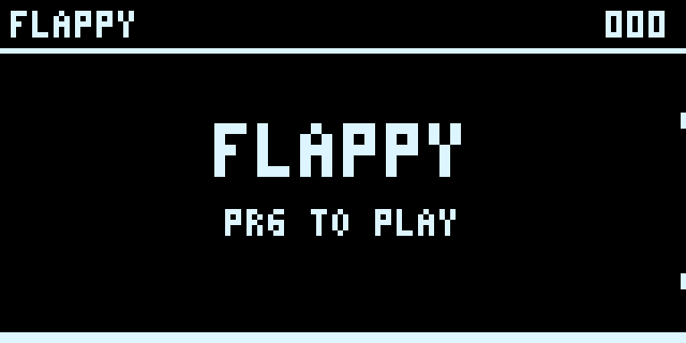

# Heltec Flappy

A small Flappy-style game for the **Heltec WiFi LoRa 32 V3**. It runs in the ESP32-S3's internal RAM and uses the built-in OLED and **PRG button**.



- Press **PRG** to start, jump, or retry.
- Press **RST**, or power-cycle the board, to return to the installed firmware.
- Scores last until the game is reloaded or the board resets.

## Load the game

Requires Python 3.10+ and a USB data cable. The included binary is ready to use; a compiler is not needed.

```bash
git clone https://github.com/Peaks2000/heltec-flappy.git
cd heltec-flappy
./setup.sh
./load-game.sh
```

The loader creates its Python environment automatically on first use if setup has not been run yet.

On a Linux desktop, install a launcher that opens a terminal and keeps startup errors visible:

```bash
./install-launcher.sh
```

Then open **Heltec Flappy** from the application menu.

Disconnect the node in Meshtastic or other serial tools first. Keep PRG released while loading. The loader automatically selects a single CP2102 serial adapter; otherwise specify the port:

```bash
./load-game.sh --port /dev/ttyUSB0
```

For Windows, use Python directly:

```powershell
py -m venv .venv
.venv\Scripts\python -m pip install -r requirements.txt
.venv\Scripts\python load_game.py --port COM3
```

The loader checks that the chip is an ESP32-S3, but cannot identify the board model from that alone. This game is built for the **Heltec V3 pinout**, not every ESP32-S3 board. An optional `--mac aa:bb:cc:dd:ee:ff` argument restricts loading to one device.

On Linux, your account needs access to the serial port. If loading reports permission denied, run the one-time USB setup:

```bash
./setup-usb.sh
```

It requests administrator authentication and installs a udev rule granting the active desktop user access to CP2102 serial adapters, including after reconnection. It does not change the board. If loading reports busy, disconnect other serial applications.

## Firmware stays installed

The loader uses Espressif's ROM RAM-loading commands. It validates the image checksum, requires every segment to fit in the game's IRAM/DRAM regions, and requires the entry point to be in instruction RAM. It does not invoke flash writes, erases, NVS writes, or eFuse programming. Meshtastic is paused while the game runs and returns after reset.

The hardware test on the original Heltec V3 verified the OLED, game input and scoring, and compared the full 8 MB flash checksum before and after running the game. This is a RAM-loading utility, not a general guarantee against hardware faults or malicious replacement images.

To check the image without accessing a device:

```bash
./load-game.sh --check
```

## Build from source

Install Espressif's [Xtensa ESP toolchain](https://github.com/espressif/crosstool-NG/releases), put its `bin` directory on `PATH`, then run:

```bash
./setup.sh
./build.sh
```

The checked-in game was built with `xtensa-esp32s3-elf-gcc` 16.1.0, Espressif release `esp-16.1.0_20260609`, and esptool 5.6.0. Set `XTENSA_GCC` to use a compiler at a different path. Building replaces `firmware/game.bin` locally.

The source uses GPIO0 for PRG, GPIO17/18 for OLED I²C, GPIO21 for OLED reset, and GPIO36 for Vext. The game also accepts serial `p` for testing; a keyboard controller is not required.

## License

The game and loader source are MIT licensed. The Python dependency [esptool](https://github.com/espressif/esptool) is GPL-2.0-or-later and installed separately. ROM entry-point addresses come from [Espressif's ESP32-S3 ROM definitions](https://github.com/espressif/esp-idf/blob/master/components/esp_rom/esp32s3/ld/esp32s3.rom.ld). See [Espressif's RAM-loading documentation](https://docs.espressif.com/projects/esptool/en/latest/esp32s3/esptool/advanced-commands.html#load-a-binary-to-ram-load-ram) for the loading protocol.
